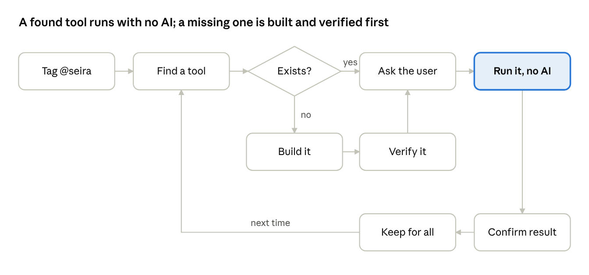

# conduit

Seira's just-in-time tool engine. Point it at a website you are signed in to; it learns the site, builds tools that create, read, update and delete records there, proves them against the live site, and serves them over MCP with no model calls at run time.



## Read first

- `journal.md`: what happened and what was decided, newest first. `problems_encountered.md`: open and resolved problems, newest first. Both append-only.
- `docs/SYSTEM_DESIGN.md`: the design. The just-in-time loop in ten steps, the three budget tiers, what exists today versus what to build, and the decisions already made.
- `docs/research/`: the research phase this repo was seeded from. `journal.md` (standing decisions, newest first), `problems_encountered.md` (open items), `HANDOFF.md` (architecture and gotchas), `COMPILER_VALIDATION.md` (the measured numbers the design cites).

## Setup

Python 3.11 or newer.

```bash
uv venv && uv pip install -e ".[dev]"
python -m playwright install chromium
cp .env.example .env
```

Fill `.env` with your own keys. It is ignored by git, as are `.conduit/` (connectors and encrypted sessions) and `artifacts/`.

## Run

```bash
python -m conduit --help
```

Commands: `login`, `create`, `compile`, `verify`, `repair`, `optimize`, `hub`, `serve`, `list`, `ui`.

## The front door (local)

`python -m conduit ui` serves the dashboard and an MCP endpoint at `http://127.0.0.1:4455/mcp`. Add it to Claude Code:

```bash
claude mcp add --transport http seira http://127.0.0.1:4455/mcp
```

It lists every verified tool across your connectors, plus `seira_find` (is there a tool for this?), `seira_build` (build one just in time; returns a job id, the build takes minutes) and `seira_status` (how is that job doing?). The endpoint accepts requests with no `Origin` header or a localhost one, so browser-based MCP clients are refused by design. Claude Desktop keeps using `python -m conduit hub` over stdio until the gateway is reachable from the internet.

## Tests

```bash
pytest --basetemp artifacts/pytest-run
```

The `--basetemp` flag is required on Windows; the default temp directory is blocked. Markers: `integration` (real browser or MCP subprocess), `desktop`, `live_model`.

## Rules

- Journals are newest first and append only.
- Never commit `.env`, `.conduit/`, sessions, or anything under `artifacts/` that a report does not need.
- No AI attribution in commit messages.
