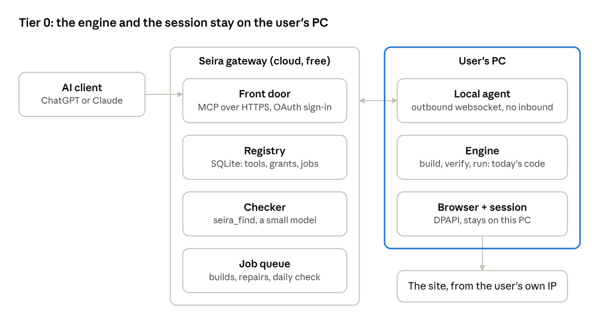

<!-- Exported from the live Claude Doc on 2026-10-18: https://claude.ai/code/artifact/01408046-4299-49c9-a3e1-18c00fba0908 . The two drawings are exported as PNG under docs/design/; the comment threads live only in the doc. Edit there, re-export here. -->

# Seira System Design

Oct 18, 2026 · @Iminabo

## 0. What Seira is

**TL;DR**

- Seira is a just-in-time tool system. A user tags @seira inside the AI they already use. Seira finds an existing tool for that site or builds one on the spot, verifies it, asks before anything irreversible, runs it, confirms the real result, and keeps the tool so the whole company has it next time.
- This is standing decision #13 in the Conduit journal, word for word. The Oct 3 demo is what it looks like to a user.
- Two engines exist today. The website engine (codename Conduit) is the just-in-time engine; it has verified tools on Vikunja, EspoCRM, BookStack, Snipe-IT, Microsoft Forms and HubSpot. The codebase engine (codename EUPHRATES) scores LLM-written servers for a repo; it is out of scope for v1 (decision 4 in §10). Neither has hosting, users, roles, approval, a registry or re-verification. That missing layer is this doc.
- Flag: a first build on a new site takes minutes and dollars today, never the demo's 18 seconds (§1.3).
- Read now: the ten TL;DRs in §1, then §2 (the free tier). Read later: §3 and §4. §10 is what only Iminabo can decide.

**How to read this**

Every section opens with a TL;DR of about five lines, then a long version for whoever builds it. Each loop step says four things: what the user sees, what Conduit does today (with the file), what changes for production, and the main and fallback choice where one is still open. "Flag" marks anything unverified or to confirm before launch. Codenames appear only in this section; after this, each engine is named by what it does.

**The whiteboard, mapped onto the loop**

| Whiteboard item (Oct 12) | Where it lives |
| --- | --- |
| check if exist | §1.2 Find |
| create: atomic vs shortest | §1.3 Build |
| updating | §1.8 Keep |
| auth | §1.1 Tag (sign-in to Seira) and §1.9 Login (sign-in to a site) |
| company, admin grant/revoke | §1.10 Company, roles, admin |
| hosting | §2, §3, §4 (the three tiers) |

## 1. The just-in-time loop

Every request takes the same path, and the only slow branch is the one where no tool exists yet.


```
Tag @seira -> Find a tool -> Exists? --yes--> Ask the user -> Run it (no AI) -> Confirm result -> Keep for all
                                |                 ^                                                   |
                                no                |                                                   |
                                v                 |                                                   |
                             Build it ------> Verify it                          (next time: back to Find)
```

Find runs every time. Only when nothing exists does the request go through Build and Verify, and even then it passes Ask before anything runs. Keep feeds the next Find, so the second request on the same site skips the slow branch. Steps 9 (Login) and 10 (Company, roles) sit under the loop and are described after it.

Each step below is written the same way: what the user sees, what the website engine does today (file named), what changes for production, and the main and fallback choice where one is open.

### 1.1 Tag: the front door

**TL;DR**

- The user types "@seira …" in ChatGPT, Claude or Copilot. One Seira server on the internet serves all of them.
- Today: local stdio servers only (`conduit/mcp_server.py:124`, `conduit/hub.py:85`). Claude Code was wired by hand. Nothing signs a user in to Seira.
- Production, main: one remote MCP server over Streamable HTTP (the pinned `mcp==1.30.0` already ships `server/streamable_http.py` and `server/auth/`); sign-in by OAuth 2.1 through a hosted identity provider's free tier; Seira only checks the token.
- Fallback: Claude first, with a per-user key sent as a fixed header. Claude allows this; ChatGPT needs OAuth.
- Flag: ChatGPT write tools on Business and Enterprise are still beta, and only admins can turn on Developer Mode there. Confirm the design partner's plan before promising ChatGPT (§11).

**What the user sees.** The demo's first beat: the same request, prefixed with @seira, now works. In ChatGPT the @ form is how a connector is addressed. In Claude the connector's tools are simply available once connected.

**Today.** `mcp_server.py` serves one connector over stdio. `hub.py` serves every verified connector over stdio by proxying the local dashboard on `127.0.0.1:4455`, so both need the dashboard running on the same machine. `generator.py` emits a generic `mcpServers` JSON and a Codex TOML. Nothing listens on the network; the README says keep it on localhost.

**Production.** One endpoint, `https://mcp.useseira.com/mcp`. Transport: Streamable HTTP. ChatGPT and Claude both accept it, both require public HTTPS, and Claude connects from Anthropic's IP ranges. Identity: OAuth 2.1 with PKCE and dynamic client registration, handled by the identity provider; Seira validates the JWT with the SDK's `TokenVerifier` and reads company, user and role from it. The token names the company and the user, and that decides what `tools/list` returns (§1.10). Per-user sign-in is what both clients expect for an org-level connector: an admin adds Seira once, each person connects with their own identity.

**Main vs fallback.** Main as above. Fallback: a per-user bearer key in a fixed header, which Claude supports and ChatGPT does not, so it is Claude-only. Never a "no sign-in" endpoint, even for a demo: that is an open tool catalog anyone can call.

**Risk.** The client plan matrix moves; the Developer Mode menu has changed twice in 2026. Treat §11 as "confirm before launch".

### 1.2 Find: check if the tool exists

**TL;DR**

- Before anything is built, Seira looks for a tool that already does this job on this site for this company.
- Today: tools live in a local folder per connector (`generator.py` `Store.write`, `.conduit/connectors/<id>/`); the hub lists only verified program tools (`hub.py:43-48`).
- Production: one `tools` table keyed (company, site, resource, verb). `tools/list` returns the verified tools this user may use, so the host model in ChatGPT or Claude picks the tool itself, with zero Seira model calls.
- `seira_find` is the separate checker Iminabo asked for on Oct 12: a small model that ranks candidates against the request and answers "use X" or "none". It is never the builder. `seira_build` refuses to build a (site, resource, verb) that already exists.
- Fallback for large catalogs (over about 80 tools): list only the meta tools plus recently used ones; `seira_find` adds a match and sends `tools/list_changed`.

**What the user sees.** Nothing, when it works: the request runs. When nothing exists, the reply says a tool is being built and how long it will take (§1.3).

**Today.** `Store` is a directory per connector holding `connector.json` (the manifest: tools, capabilities, verification report, `notes`), `server.py`, client configs and a full copy of the package. `hub.py` names tools `<8-char hash of the connector id>__<tool>`; the hash avoids name collisions and is not a tenant boundary.

**Production.** Table columns: company, site\_origin, resource, verb, name, input and output schema, program (the family JSON), fingerprint (first 16 hex characters of sha256 over the family, `programs.py:815-817`), verification report, status (verified, degraded, repairing, retired), created\_by, last\_verified, last\_error. Three meta tools: `seira_find(request)`, `seira_build(request)`, `seira_status(job)`. The checker is a separate model from the creator so a growing catalog never bloats the creator's context, which is the reason Iminabo gave on Oct 12.

**Risk.** The checker says "none" for a tool that exists under another resource name, and a duplicate build costs $5 to $90. The guard is the refusal in `seira_build` on an existing key, which only works if the key is normalized: site origin plus resource noun plus verb, not the user's phrasing.

### 1.3 Build: just-in-time, from the request

**TL;DR**

- When no tool exists, the request is the build order: the site, the resource and the verb the user asked for set what gets built and how big it is (Scott's "altitude").
- Today the whole pipeline exists on one laptop: `discovery.py` → `recorder.py`/`evidence.py` → `compiler.py` passes → `programs.py` step programs → `grounding.py`. It has produced verified tools on six sites.
- Production: `seira_build` replies at once with a job id and an honest ETA, streams progress, and publishes what passed (standing decision #11). Two speeds: fast = one operation by the shortest path the site offers; thorough = a full create/read/update/delete family through every gate.
- Atomic vs shortest: default atomic families. Shortest when the site's own action means something different from the composition (Move keeps history and IDs, delete + create does not), when composing would take more than five calls (five is a working number, still to be tested), or when no family can express it. Guide below.
- Flag: a build takes minutes and dollars, never the demo's 18 seconds: $0.79 to $6 on the demo sites, $88 and 20 attempts on HubSpot. The first reply on a new site must say "building, about N minutes", and the demo's timer badges should go.

**What the user sees.** "No connector for X. Building one from the live portal…", then progress, then the Ask card. Standing decision #13 holds: the user never sees a run, a pass or a learning session.

**Today, by file.**

1. `discovery.py` opens up to 3 same-origin pages (max 8), skips logout and delete links, turns plain forms into candidate tools (skipping forms with password, file, checkbox or radio inputs), probes for OpenAPI, and adds the browser and `task_*` fallbacks.
2. `recorder.py` and `evidence.py` record, each pass, the scrubbed DOM and frames, up to 8 scripts plus source maps, the accessibility tree, non-secret localStorage, the names of secret-looking bindings, and redacted network events (160 rolling plus pinned writes). Crawl4AI (`crawl4ai_evidence.py`) is optional and off by default: it adds a Markdown view and a control list, but cut input tokens by only 2% on EspoCRM and raised them 30% on BookStack.
3. `compiler.py` runs up to 8 learning passes (the CLI allows 1 to 60). Each pass the model picks one action: read source, explore read-only, `probe_record`, `recover_record`, propose, revise, done. `record_probe.py` fills a form with one marked disposable record ("Conduit learning \<uuid>"), reads it back by id and marker, deletes it once, and re-checks absence after a browser restart.
4. `programs.py` is the output: a step program, not free code. Step kinds: request, navigate, click, fill, press, read, select, command, download, upload, draw, set, assert, if, poll. Budgets: at most 40 steps (80 nested), 160 executed, 30 s default timeout, JavaScript at most 64,000 characters.
5. `grounding.py`: a write URL must match traffic the site's own frontend was seen making, or a path in its delivered code. Vendor docs do not count.
6. The request text already reaches the compiler as `user_notes` (`compiler.py:482`). That is the altitude hook. It is also the leak: the same field is served to MCP clients as instructions (§1.9).

**Production.** `seira_build(request)` returns at once with the job id, the ETA and what will be built. The build runs wherever the user's session lives (§2 to §4), under the requester's own login, so it can only learn a resource that person can open: no tool is built for a folder or record the requester cannot reach. Progress goes out as MCP progress notifications. Budget caps are checked before the compiler starts (§8). On success the family is registered (§1.2) and the client gets `tools/list_changed`. For the codebase engine, `euphrates/generator.py` writes a FastMCP server, `euphrates/tester.py` `test_server` scores it, and only passing tools register. Out of scope for v1 (decision 4 in §10).

**Two speeds.**

- Fast, one operation: the shortest path the site offers for exactly the verb asked. Today `single_operation.py` does this for `update` only; generalize the verb. Use it for "do X once" requests and for sites where a full family is not worth building yet.
- Thorough, a family: create/read/update/delete with readback, through the three gates. Use it when the request implies repeated use, or when a write needs a readback to be trusted. This is the default for company-shared tools.

**Atomic vs shortest: the guide.**

Default: atomic families. The verifier already produces and proves them (`verifier.validate_family` requires a family with readback); the host model composes bigger actions from them, each with its own approval; and one family serves many phrasings, so the registry does not fill with near-duplicates.

Use the site's own composite action (shortest) when any of these holds:

1. The semantics differ. Drive's Move keeps the file's id, history and sharing; delete + create does not. A court's "file this motion" is one transaction with one confirmation number.
2. The composition would take more than five tool calls (five is a working number, still to be tested), or crosses a step the site treats as irreversible between calls.
3. No family can express it: a canvas action, a wizard with server-side state.

When shortest is chosen, build it as a single operation and record which atomics it covers, so `seira_find` can match later requests to it. Example: "arrange my folders" on Drive becomes an atomic family on files (read, create folder, and move via the site's Move because rule 1 applies); the host composes "arrange".

**Risk.** Build cost and time make "just-in-time" a promise about the second request, not the first. Say so in the product and in the pitch.

### 1.4 Verify: the gates

**TL;DR**

- Nothing is published until it has done the job for real, several times, cleaned up after itself, and survived a restart.
- Today's gates: (1) `verifier.py:296-471` runs 3 lifecycles; each creates a control record and a test record, then reads, updates, reloads and deletes, checking the control record stayed untouched; the browser restarts before the last cycle; at least 2 distinct inputs. (2) `mcp_check.py:81-258` runs the staged bundle as a real stdio MCP server with learning disabled, across 2 restarts, and fails any tool that made a model call. (3) An independent observer (REST read-back) when a script passes `observe`; `compile_connector` does not, so HubSpot's report says `independent_observer: false`.
- Production: unchanged for website tools. Codebase-engine tools go through `euphrates/tester.py` `test_server`: one call per tool, with the environment-fault vs model-fault split.
- Flag: the codebase gate is weaker (one call, no lifecycle). Out of scope for v1 (decision 4 in §10).

**Today.** The three gates as above. The control record is what makes "did it touch anything else?" answerable. `mcp_check.py:149-150` enforces zero model calls, but the metric it checks is a literal `0` written at `programs.py:812`, not a measurement; the real guarantee is structural, because no screenshot step kind exists (`javascript.py:15`). Make it measured (§1.6).

**Production.** Gates run on the same machine as the build. A tool that passes gets status verified and a fingerprint; one that fails stays unpublished and the job reports why. Standing decision #11 applies: publish the verbs that passed even when the family is incomplete.

**Risk.** Lifecycles create and delete real records. On a production site that is a write to the customer's data (the "Maria Johnson" sample contact was deleted by a cleanup matcher on Oct 3 and not restored). Run write lifecycles only on sites the admin marked test-safe, or in a sandbox account (§1.8).

### 1.5 Ask: approval before anything irreversible

**TL;DR**

- The demo shows a Deny/Allow card before each filing or retry. Today's code has none: standing decision #4 says "connected means approved".
- Main: let the client's own card do it, and make it truthful. ChatGPT confirms write tools by default and shows the exact input; Claude prompts per tool. Seira's annotations already mark every write as destructive (`mcp_server.py:48-53`), and the read-before-write guard with `state_token` (`verifier.py:200-263`, `state_guard.py`) is the demo's "catches mistakes before acting".
- Add Seira's own card only for delete and for money-moving or irreversible actions (a filing fee, a tax return), using MCP elicitation in form mode when the client supports it. Standing decision #4 stays: once a user is signed in, their tools run. The card is a safety step on irreversible actions, not a permission layer.
- Fallback for clients with neither card nor elicitation: a two-step `confirm_token` (the first call returns the preview, the second carries the token).
- Decided Oct 18 (decision 1 in §10): the client's card plus Seira elicitation for irreversible actions. #4 stays as the permission rule; the card is a safety step, not a permission.

**What the user sees.** A card naming the exact action and its scope ("Retry fulfillment for 3 orders? #3061, #3058, #3057"), with Deny or Allow. For reads, nothing.

**Today.** No confirmation layer. What exists is better than a card for catching mistakes: before update or delete the executor does a fresh read, refuses a stale `expected_state_token`, and returns `object_missing` rather than guessing. Annotations: `readOnlyHint = read_only`, `destructiveHint = not read_only`, `idempotentHint = read_only`, `openWorldHint = True`.

**Production.** Three layers. (1) Honest annotations plus a description that states the exact effect, so the client's card is informative; keep `destructiveHint` true for update and delete, and false for create. (2) Server-side elicitation for delete and irreversible actions: the server returns `input_required` with the arguments it will execute, the client shows a form, and the call proceeds only on the client's retry carrying the answer; the answer and the user are logged (§9). (3) Nothing more: standing decision #4 holds, so a signed-in user's tools run without a permission prompt; access exceptions are the admin's per-item blocks (§1.10). Why not a Seira card on every write: ChatGPT already shows one, so users would see two prompts per action.

**Risk.** Client confirmation is client policy. Claude's Research mode can call tools without approval, and "Allow always" exists. The elicitation layer on destructive tools is what Seira can promise regardless; the setup guide must say to keep write tools out of Research mode.

### 1.6 Run: zero AI in the hot path

**TL;DR**

- A verified tool runs with no model call and no screenshot. The call path is `runtime.py:46-102`: validate the input, refuse writes in read-only mode, require `verified_program`, require the fingerprint to match, take the browser lock, then `FamilyExecutor.call`: a fresh read first for update and delete, run the program, re-read up to 6 times, persistence check, save the session, return a receipt with `state_token`.
- Every program tool needs a browser today, even HTTP-replay ones, because `ProgramRunner.run` always starts the session (`programs.py:787`) and `$session` bindings read live cookies. HTTP-replay tools take milliseconds warm (Vikunja create: 337 ms); UI-driven ones 12 to 48 s (HubSpot), about a minute from a cold client, 10 to 15 s of it browser startup.
- Production: keep one warm browser context per (user, site) with a 15-minute idle timeout; send progress notifications on long calls; measure `model_calls` instead of the literal at `programs.py:812`; reap leaked Chromium (82 leaked processes were logged on Oct 3).
- Fallback: if a client's call timeout is under 60 s, a browser-driven write returns a job id and `seira_status` reports.
- Flag: ChatGPT's and Claude's tool-call timeouts are unmeasured. Measure them before the first demo on a UI-driven site.

**Today.** As above. The executor is the same class the verifier uses, so production calls get the same readback discipline as verification. Only OpenAPI-imported `http` tools run without a browser, with credentials from environment variables (`runtime.py:107-155`).

**Production.** Gateway to the caller's (company, user, site) runtime, then `Runtime.call`. A per-user runtime map; today `app.py` keys only by connector. Progress through the hook already in `Runtime.call`. Egress limited to the connector's `allowed_origins`; `net.py` and `browser.py:227-233` already abort navigation outside them. The `task_*` and `browser_*` fallback tools, which do call a vision model, are never listed in production: `hub.py` already filters to verified programs, `mcp_server.py` does not.

**Risk.** HubSpot-class sites only work UI-driven: 127 writes were recorded during learning but no capturable HTTP write request, because HubSpot's in-app writes go through an internal RPC. One minute per call is the cost of that site, not a limit of the engine.

### 1.7 Confirm: submitted is not processed

**TL;DR**

- A tool reports done only when the site shows the change: the demo's clerk-stamped copy, warehouse ledger ids, confirmation numbers.
- Today this is already the rule. `FamilyExecutor.settle` re-reads the record after every write; `poll` steps wait for a state (at most 10 attempts, 2 s apart); the persistence check re-reads after a reload; the compiler prompt says "Do not claim success early" (`compiler.py:231`) and that an unknown creation cannot be dismissed just because a search returns nothing.
- An uncertain write (the program changed something and then lost its binding) is marked `uncertain` and never retried blindly (`programs.py:805-806`).
- Production: unchanged. Receipts keep the state token and the readback; audit rows store paths and hashes, not record values (§9).
- Flag: none.

**Today.** The receipt returned to the client carries the readback and the `state_token`. `mcp_check.assert_record_matches` already reports paths rather than values; make that the rule for anything stored.

**Production.** This is the demo's final summary ("filed, accepted, stamped copy attached"). Nothing new to build beyond redaction in storage and a receipt format the host model can summarize.

### 1.8 Keep: updating when a site changes

**TL;DR**

- Oct 12 decision: no cron over every tool. A tool is re-verified when someone uses it and it fails, plus one cheap daily check per site.
- Today: `repair` and `verify` are manual CLI commands; a failure's `last_error` lives only in memory (`runtime.py:73-75`); nothing is scheduled.
- Production: a non-uncertain `ProgramError` (a locator miss, `postcondition_failed`) marks the tool degraded, hides it from `tools/list`, and queues `compiler.repair_connector` with the failing user's session (one revise pass, roughly 17k tokens in and 13k out). The repair re-runs every gate (§1.4), republishes the new fingerprint to the whole company, and sends `tools/list_changed`. The caller gets "tool unavailable, repair queued"; there is never a model call inside the request (standing decision #3).
- Daily check per site, not per tool: `login.confirm` on each stored session plus one read-tool call per family. No disposable writes. Write lifecycles only on sites marked test-safe or in a sandbox account.
- Fallback: manual `seira repair <tool>`.

**What the user sees.** Either nothing, because the tool still works, or "this tool stopped working on X; repairing, about N minutes" and a notice when it is back.

**Today.** The pieces exist: `repair_connector` in `compiler.py`, `verify_export` in `mcp_check.py` with a control object, and the `needs_attention` cleanup that blocks compiles until leftovers are dealt with. Nothing marks a connector as sandbox or production.

**Production.** A status column on the registry: verified, degraded, repairing, then verified again or retired. Repair runs in the build worker, never in the request path. The time of a site's deploys is unknowable (Holy's point on Oct 12: it depends on the team's time zone), so the daily check runs at a fixed time and the on-use check catches the rest. The Oct 12 estimate was that legacy, finance and legal sites rarely redesign while modern SaaS ships often; the on-use check makes that irrelevant.

**Risk.** A repaired tool is model-written code republished to everyone. The Sept research rules say a human reviews emitted tools. v1 can satisfy that by auto-publishing repairs of read-only tools and holding write-tool repairs for an admin's approval (§6).

### 1.9 Login when a site needs it

**TL;DR**

- A tool runs as the user who signed in to the site, with that user's permissions. Seira never holds a password.
- Today: `conduit login <id>` opens a headed browser (`cli.py:208-261`); cookies and localStorage are checkpointed on every browser event (`browser.py:443-469`); the state is encrypted with Windows DPAPI and bound to that Windows user (`secrets.py:8-36`; other OSes get plaintext JSON with chmod 600); it is loaded once at browser start (`browser.py:192`); one exclusive file lock per connector (`session_lock.py`).
- Four bugs, all fixed Oct 18, found the first time an outside client drove a connector (problems\_encountered.md, Oct 4): (1) `browser_close` saves before releasing, so signed-out cookies can overwrite a good login; (2) a running server never re-reads the session file; (3) one owner, no handoff, so an expiring session strands any connected client; (4) `manifest.notes` ships build instructions to MCP clients (`mcp_server.py:36`). The fixes, in any tier: save only after `looks_signed_in` passes (`login.py:35`); reload the session file before each call; a lease with expiry instead of the lock; strip `notes` from the instructions.
- Sessions are per (user, site) and never shared. A colleague runs your tool under their own login, so the site's own permissions apply and Seira never escalates anyone.
- Decided Oct 18 (decision 2 in §10): v1 keeps sessions on the user's PC (§2); cloud sessions are a stretch opt-in in v1 and the default from v2 onward (§3 and §4).

**What the user sees.** When a tool needs a site they have not signed in to: "Sign in to X to continue", a link, and the call resumes after sign-in. MCP's URL-mode elicitation exists for exactly this; credentials never pass through the client or the model.

**Today.** `login.py` also has `scripted_login(user=, password=)`; that path must not survive into production. `login.confirm` fingerprints the signed-in page, so a later check can tell "still signed in" from "bounced to the login page".

**Production.** Per tier. Common parts: a session store keyed (company, user, site); the `looks_signed_in` gate on every save; URL-mode elicitation to start a sign-in; a TTL and a revoke; never a password through chat.

**Risk.** Standing decision #5 (session encrypted locally, never exported) is honored by the local-agent design and violated by cloud sessions. Cloud sessions make Seira a custodian of customer credentials for third-party sites. That needs its own consent and the §4 controls.

### 1.10 Company, roles, admin

**TL;DR**

- Oct 12 and Oct 18 decisions: one person's tool serves every signed-in colleague by default; the admin's job is the exception, blocking or revoking one person's access to one item, never a whole site at once. Two kinds of "no" exist, handled in different places. A site whose terms forbid automation (Amazon) is not a reason to refuse a build: the tool is built and it works (Iminabo, Oct 18). Whether that exposes Seira or the customer is a legal question to put to experts before a paying customer; the §9 kill switch stays for a cease-and-desist. A resource a user cannot open (a folder they are not shared on) gets no tool and no operation for that user, because builds and runs happen inside their own session and can only reach what they can.
- Today: nothing. `Store` is a flat directory with no owner; one session per connector, tied to one Windows user; the only restriction is `--read-only`.
- Production: three tables. `companies`; `users` (identity-provider subject to company and role, admin or member); `blocks` (user, by site, by tool or by record id). Default is allow: a signed-in user sees every verified tool for their company's sites. `tools/list` drops that user's blocked tools per request (the MCP spec allows the list to vary by the authorization presented), and a call on a blocked record is refused server-side. A block or unblock sends `tools/list_changed`. Admin actions are two admin-only tools, `seira_block` and `seira_unblock`; no UI (standing decision #7).
- Programs are shared; sessions never. A tool Holy built runs for Angel under Angel's login. If it breaks for Ben at noon and is repaired, Angel at 2 pm gets the repaired fingerprint.
- Fallback: an admin-approved shared service-account session per site, later and opt-in.

**What the user sees.** Every verified tool for their company's sites, minus anything blocked for them. An admin sees two more.

**Today.** The hub's 8-character hash prefix is a naming fix, not a tenant boundary. Holy's Salesforce example from Oct 12 is the model: a UI bundle shared to others shows each person only what their permissions allow.

**Production.** Every registry key carries the company id. The site's own permissions do most of the work, because each person runs a tool under their own login. The block table handles the one case the site gets wrong. Iminabo's example: a folder shared with five people, nine of ten items open to all, and one person who should not reach the tenth; an admin blocks that person from that item, not from the folder. "Sessions never shared" is what keeps the site's permissions in charge.

**Risk.** Nobody on the team has built access control before (Iminabo, Oct 12). Default-allow plus a small block table is the least to build; use the identity provider's groups for the admin role.

## 2. Tier 0: hackathon, free

**TL;DR**

- The loop, with today's engine running as a local agent on each user's PC and a tiny gateway in the cloud. Nothing paid.
- Gateway (a free VPS tier, or a laptop behind Cloudflare Tunnel for the hackathon): the MCP front door over Streamable HTTP, the registry (SQLite), the checker call, the job queue. It never holds a site session.
- Local agent (today's runtime plus a client of about 300 lines): connects outbound to the gateway over a websocket, so no inbound ports; receives tool calls and build jobs for its user; runs them in the user's own browser session; returns receipts. Sessions stay local under DPAPI; login is today's `conduit login`. Builds run here too, because the session is here.
- Sign-in to Seira: OAuth through a free identity-provider tier (WorkOS AuthKit or Auth0). Fallback: per-user bearer keys, Claude only. Roles: a JSON file of users, admins and blocks. Audit: an append-only log on the gateway.
- Cut: cloud sessions, Browserbase, per-call sandbox, an audit database; the codebase engine can join later. Customer zero is the team, then one partner whose users can run the agent. About two weeks of hackathon-grade work. Risk: a user on a locked-down laptop cannot install the agent.



```
[AI client: ChatGPT or Claude]
        |  MCP over HTTPS, OAuth sign-in
        v
[Seira gateway, cloud, free]            <--outbound websocket, no inbound-->   [User's PC]
   Front door   (MCP over HTTPS)                                                  Local agent
   Registry     (SQLite: tools, grants, jobs)                                     Engine: build, verify, run (today's code)
   Checker      (seira_find, a small model)                                       Browser + session (DPAPI, stays on this PC)
   Job queue    (builds, repairs, daily check)                                         |
                                                                                       v
                                                                             [The site, from the user's own IP]
```

The client talks only to the gateway; the gateway talks to the user's agent over a connection the agent opened; the site only ever sees the user's own browser and IP.

**Why this shape.** It is the smallest change to what works today. The engine, the gates and the sessions stay where they are; only the front door and the registry move to the cloud. It honors standing decision #5 (sessions never exported), keeps credentials with the customer (the Sept legal rule), and avoids anti-bot entirely because traffic comes from the user's own machine.

**What to build, in order.**

1. Gateway: a Streamable HTTP MCP server from the SDK; `tools/list` and `tools/call` backed by SQLite; the three meta tools; bearer-key auth first, OAuth when the identity provider is wired. Strip `notes` from the instructions (§1.9, bug 4). Done Oct 18, with an in-memory index over `connector.json` instead of SQLite and bearer keys from `users.json`; OAuth and the cloud placement remain.
2. Agent client: wraps `app.py`'s runtime map; an outbound websocket carrying the user's key; executes `Runtime.call` and `compile_connector` jobs; streams progress; reports receipts. Fix session bugs 1 to 3 (§1.9) in the same change. The three session bugs were fixed Oct 18. The websocket agent is deferred: the engine runs beside the gateway on one machine, and the split returns only for a user who must keep the engine on their own PC.
3. Registry: the `tools` table (§1.2) plus a `users.json` for roles (§1.10); `seira_find` with a small model. Done Oct 18: `users.json` holds keys, roles and blocks, and the model is asked only when the deterministic match cannot decide.
4. Keep: degrade on failure, a repair job on the agent, republish; the daily read-only check runs from the agent while it is online. Done Oct 18, with the repair in the gateway's job worker; the daily check judges each stored session and makes no read, because verification keeps no record id to read.
5. Ask: honest annotations; elicitation for delete where the client supports it (§1.5). Done Oct 18, with a one-use `confirm_token` for clients without elicitation and an append-only `audit.jsonl`.

**Customer zero.** The team: four agents, one gateway, the demo sites plus HubSpot's dummy portal. Then one design partner with two or three users.

**Cut, and why.** Cloud sessions need consent and controls Seira cannot offer yet. A per-call sandbox is unnecessary when one user, one machine and one session are involved: the user's own browser is the sandbox. A log file is enough audit for one partner. The codebase engine needs no agent and can register through the same registry later.

**Risks.** A user who cannot install anything cannot be served; that is the §3 case. The agent must be online for the user's tools to run; when it is not, the gateway answers "your Seira agent is offline". A laptop gateway behind a tunnel is fine for the hackathon, not for a partner: move the gateway to a VPS before the first partner.

## 3. Tier 1: about $50 a month

**TL;DR**

- The same loop, but builds and runs move to the cloud, so users install nothing. One container per company on a VPS of about $15 a month (4 vCPU, 8 GB): Caddy for TLS, then the gateway, then an in-process hub that owns the runtimes, a Playwright browser image, and compile and repair workers capped at one build at a time and 45 minutes each.
- Sessions live server-side, encrypted with libsodium under a per-company key (DPAPI goes; the code path is `secrets.py`). Sign-in: a tool call that needs a site returns URL-mode elicitation; the link opens a headed browser in the container streamed over noVNC; `login.watch_for_sign_in` saves the state. The hub is the sole owner of every browser, which removes session bugs 1 and 3 by construction; bug 2 still needs the reload.
- Browser-driven tools run in the cloud too. Browserbase Developer ($20 a month, Contexts for saved logins) is the escape hatch for sites that block datacenter IPs; the Tier 0 agent stays available for customers who need it.
- SQLite until company #2, then Postgres. Audit rows in the database. The identity provider stays on its free tier.
- Risk: anti-bot. The Sept rule "never disguise agent traffic" means no stealth plugins, so a Cloudflare-fronted partner site may challenge the VPS. Test the partner's site from the VPS in week 1; that is the go or no-go for this tier.

**Why move to the cloud.** Per decision 2 this is the default from v2 onward. Users on locked-down laptops, teams that will not install an agent, and a demo that works from any device. The price is that Seira now holds customer sessions for third-party sites (§1.9 risk), which needs its own consent line at connector setup.

**What changes from Tier 0.** Build and run move from the agent into the container; `app.py`'s runtime map and `build_slots` are the kernel to host, while `desktop.py`, `windows.ps1` and DPAPI are out. A per-user runtime map replaces the per-connector one. The noVNC login page is new, about two days. Compile in the same image you run in, for user-agent and browser-channel parity. The daily check runs in the container.

**Costs.** VPS about $15; Browserbase $20 when needed; a domain; identity provider free. See §8.

**Risks.** One container is one failure domain: a runaway build can starve the browsers, hence the caps. Datacenter IPs are the thing Web Bot Auth is built to tier; Seira can sign its requests once it publishes a key directory (§4), but a signature proves identity, not permission.

## 4. Tier 2: about $200 a month

**TL;DR**

- Tier 1 plus the controls a security reviewer would require before a real company's sessions live in Seira's cloud.
- Browser-driven tools run in Browserbase Startup ($99, Contexts) or a self-hosted browser pool, with a per-user context encrypted under a per-company key, a TTL and a revoke; cloud-held sessions are per-customer opt-in with their own consent.
- One sandbox per tool call (a container or microVM) with no cloud credentials in its environment and an egress allow-list equal to the connector's `allowed_origins`, enforced at the network layer. The registry signs each fingerprint at publish (Ed25519) and the runner verifies the signature, so editing `connector.json` can no longer re-fingerprint a program; today `runtime.py:64-67` checks the hash against the same file.
- Append-only audit per call: company, user, tool, fingerprint, argument hash, state token in and out, outcome, approval answer; a retention policy and a data-processing agreement. Learning evidence is deleted after publish and values are redacted in reports.
- A paid identity-provider tier for SSO; a Web Bot Auth key directory and signed requests from Seira's IPs; health-check write lifecycles only in customer sandbox spaces; a per-site kill switch that revokes scopes company-wide, which is the cease-and-desist answer.

**Why.** Standing decision #5 is violated the moment sessions live in the cloud. These are the controls that make that defensible: isolation per call, signed programs, audit, consent and a kill switch.

**What changes from Tier 1.** The browser pool; the sandbox runner; signing in the registry; the audit schema; a retention job; SSO; signed requests.

**Costs.** Browserbase $99; VPS $15 to $40; identity provider about $50; domain and logs. See §8.

**Risks.** Complexity for a four-person team. Nothing here is needed to serve customer zero or a partner who accepts the Tier 0 agent. Build it when a customer's security review asks for it.

## 5. What an agent can't do

**TL;DR**

- Scott's challenge was "what do you do that an agent can't?" The answer is not the generation; any agent can write an MCP server. It is the six guarantees below, each enforced by code rather than by a prompt.
- (1) Zero model calls and zero screenshots inside any published tool call (`mcp_check.py:149-150`; receipts carry `metrics`). (2) Every published website tool passed three CRUD lifecycles with an untouched control record and a browser restart, then ran as a real MCP server across two restarts with learning disabled (`verifier.py:296-471`, `mcp_check.py:81-258`). (3) A program cannot run unless its fingerprint matches what was verified (`runtime.py:64-67`). (4) Every write is confirmed by fresh readback before it returns, a stale state token is refused, and an uncertain write is never retried (`verifier.py:216,247-263`, `programs.py:180`). (5) A published tool can reach only the origins it was verified against (`net.py`, `browser.py:227-233`). (6) `tools/list` is filtered server-side by the caller's company and blocks, and every destructive call is logged with the user who approved it (to build: §1.5, §1.10, §9).
- Flag: guarantee 2 holds for the website engine only. Codebase-engine tools pass one call per tool; they are out of scope for v1 (decision 4 in §10).
- Measured on HubSpot: 20 compile attempts, 16 compiler fixes, then four verified tools, and an outside client's first real delete on Oct 4.

**Why this is the product.** The agent writes the first draft. Seira proves it, refuses to run anything unproven, keeps it working when the site changes, and shares it under the company's rules. None of that comes from "ask Claude to write an MCP server".

## 6. Must not ship in v1

**TL;DR**

- Three things are tempting and wrong for v1. Each has a cheap alternative.
- (1) Cloud-held sessions by default. Instead: the Tier 0 agent, with cloud sessions as a per-customer opt-in (§3).
- (2) Model-repaired tools published automatically, or a repair inside a request. Instead: a repair queue that re-runs every gate; auto-publish read-only repairs only; an admin approves write-tool repairs (§1.8).
- (3) The `task_*`, `browser_*` and `task_do` fallback tools in the production catalog. They call a vision model and can overwrite a session (`agent.py:62-115`). Instead: serve only verified program tools, as `hub.py` already does, and keep the fallbacks for the build sandbox.
- Also out: the `scripted_login(user=, password=)` path in `login.py`, and `manifest.notes` in client instructions.

## 7. Exists today vs to build

**TL;DR**

- Most of the loop exists: build, verify, run, confirm, and since Oct 18 a local front door and registry (`gateway.py`, `registry.py`). What is missing is everything around it: sessions off one PC, approval, update scheduling, roles, hosting.
- `problems_encountered.md` lists what is still open; the four session bugs and the `notes` leak are closed (Oct 18). What blocks every tier now is the burned key in the shared Drive doc and the missing sign-in to Seira itself.
- The burned API key still sitting in the shared Drive doc must be rotated before anything is hosted.

| Step | Exists today (file) | Open problems touching it | To write |
| --- | --- | --- | --- |
| 1 Tag | stdio servers `mcp_server.py`, `hub.py`; client configs `generator.py`; Streamable HTTP gateway `gateway.py` at `/mcp` inside `conduit ui`, local-only (Oct 18) | no auth on the endpoint: 127.0.0.1 only, Host and Origin checks; progress heartbeat not implemented | tunnel; OAuth and JWT check |
| 2 Find | `generator.py` `Store`; `hub.py` verified-only listing; `registry.py` in-memory index refreshed by `connector.json` mtime; `seira_find`, `seira_build`, `seira_status` in `gateway.py` (Oct 18) | every connector carries a full package copy under `_runtime`; no SQLite until Keep and the cloud tiers | model-backed re-ranker behind `seira_find`; registry table with company scope |
| 3 Build | `discovery.py`, `recorder.py`, `evidence.py`, `compiler.py`, `record_probe.py`, `programs.py`, `grounding.py`, `single_operation.py` | compiler prompt unversioned and untested; truncated model output gets closing braces added silently; form parser drops checkbox, radio, file and password forms; single-operation hardcodes `update`; unassisted canvas discovery never completed | async job with ETA; verb generalization; altitude taken from the request |
| 4 Verify | `verifier.py`, `mcp_check.py`, the observer hook, `euphrates/tester.py` | no independent observer for Snipe-IT or Forms; the cleanup matcher deleted a sample contact | test-safe flag per site; measured `model_calls`; codebase engine deferred to v2 |
| 5 Ask | annotations in `mcp_server.py` and `gateway.py`; `state_guard.py`; read-before-write in `verifier.py`; delete confirmation in `gateway.py` (elicitation, else a one-use `confirm_token`) and `audit.py` (Oct 18) | none | the same card for money-moving and other irreversible actions; standing-approval scope |
| 6 Run | `runtime.py`, `programs.py`, `net.py`, `browser.py` | 82 leaked browser processes; the recorder is passive, no intercept | per-user runtime map; warm contexts; reaper; progress |
| 7 Confirm | `FamilyExecutor.settle`, `poll`, the persistence check | none | redaction in stored receipts |
| 8 Keep | `compiler.repair_connector`, `mcp_check.verify_export`, `needs_attention`; `keep.py`: degraded status persisted, repair job, daily session check (Oct 18) | the daily check makes no read: verification keeps no record id | admin review of repaired write tools; repair with another user's session |
| 9 Login | `login.py`, `browser.py` checkpoints with the save guard, `secrets.py` DPAPI, `session_lock.py` lease (Oct 18) | a burned key in the shared Drive doc | session store per (user, site); URL elicitation |
| 10 Company | `users.py`: keys, admin or member, blocks by site, tool or record; `seira_block` and `seira_unblock` (Oct 18) | one users.json per machine, no companies | companies; identity-provider groups for the admin role |
| Hosting | `app.py` (FastAPI, job workers, `build_slots`), `requirements.lock` | localhost only, by design | per tier (§2 to §4) |

Crawl4AI stays optional and off by default; it is evidence, not a replacement for it.

## 8. Cost

**TL;DR**

- Creation is the only expensive step, and it is paid once per site and family per company. Running costs no model tokens.
- Measured builds: Vikunja $0.79, EspoCRM $0.91, Snipe-IT $0.93, BookStack $4.94 (8 calls, 870k input tokens); Microsoft Forms about $6 over three runs (1.26M input tokens); HubSpot $88.12 across 20 attempts, with the final run at 289k tokens in, 16k out, 1,246 s including 714 s of lifecycles and 293 s of the MCP gate. A typical build is 2 to 8 model calls and 1 to 20 minutes.
- Checker: under $0.01 per find with a small model. Run: $0 in model cost, about 0.5 GB of RAM per warm browser context. Repair: $1 to $3, one revise pass. Daily check: $0 in model cost, about a minute of browser time per site.
- Infrastructure: Tier 0 $0; Tier 1 about $15 for the VPS plus $20 for Browserbase when needed; Tier 2 about $150 to $200.
- Hard caps in the gateway before the compiler starts: $25 per family and $150 per company per month. The HubSpot number is why.

**Where the tokens go.** Each learning pass re-sends the evidence; BookStack's 870k input tokens over 8 calls is the shape of it. Crawl4AI did not help (2% fewer tokens on EspoCRM, 30% more on BookStack). The lever is fewer passes, not a different model. Iminabo's Oct 12 estimate was that Fable used fewer tokens than Astra on the same tasks; that is unmeasured and should be.

**Credits.** The team's own API credit is the binding constraint today (Oct 5 meeting). Rotate the burned shared key, and use one workspace-scoped key per deployment.

## 9. Risks and rules

**TL;DR**

- Terms of service: many sites forbid automated access outside their API. The defensible position, from the Sept research, is that the customer automates their own account with their own credentials; Tier 0 makes that literally true. Rules: never disguise agent traffic (`net.py` already sends `Conduit/0.1` as the user agent); prefer the documented API when an HTTP-replay tool lands on one; acknowledge the site's terms at connector setup; a site's terms forbidding automation (Amazon, for one) is not a reason to refuse a build, by Iminabo's call on Oct 18, and the exposure that creates is an open question for legal experts before a paying customer; keep a kill switch that revokes a site company-wide for a cease-and-desist; stop on any cease-and-desist.
- Anti-bot: datacenter browsers get tiered or blocked. Web Bot Auth (signed requests plus a public key directory) is how a hosted Seira identifies itself, and it proves identity, not permission. Tier 0 avoids the problem; Tiers 1 and 2 test each partner site first.
- Data: learning evidence is recorded traffic from the customer's signed-in session. Keep it in the build sandbox and delete it after publish, keeping ids and hashes only. Receipts and reports store paths, not values. One audit row per call: company, user, tool, fingerprint, argument hash, state token, outcome, approval. A retention period and a data-processing agreement when a real company signs.
- The four session bugs (§1.9) are the top engineering risk: all four were found on the first outside client, and none is covered by a test.
- The compiler prompt forbids copying secret values into programs (`compiler.py:212`). Keep that rule and test it.

**The exposure Tier 0 removes.** If Seira's servers hold the session and send the traffic, Seira is the party automating the site. If the user's own browser does, the user is. That is the single strongest reason to start with the agent.

## 10. Decisions for Iminabo

**TL;DR**

- Decided by Iminabo on Oct 18. Three stand as recommended, one is deferred, and one was the wrong question; the answers are below.

1. **Approval: decided.** The client's card plus Seira elicitation for delete and irreversible actions (§1.5).
2. **Where sessions live: decided.** v1 on the user's PC (§2). Cloud sessions are a stretch opt-in in v1 and the default from v2 onward (§3, §4).
3. **Atomic vs shortest: decided.** Atomic by default, shortest by the rules in §1.3. The five-call threshold is a working number, still to be tested.
4. **Codebase-engine tools: deferred.** Out of scope for v1; the product is the website engine only. Nothing in §1 to §9 depends on it.
5. **Standing decision #4: stays, reframed.** "Connected means approved" is the permission rule: once a user is signed in, their tools run. The admin does not pre-approve anything; the admin blocks or revokes one person's access to one item when a site's own permissions let something through (§1.10). The card in decision 1 is a safety step on irreversible actions, not a permission. Clarified Oct 18: the site's permissions are the gate for what a person can reach (no access to a folder means no tool and no operation on it), while a site whose terms forbid automation is not Seira's gate: the tool is built and works, and the legal exposure is an open question for experts (§1.10, §9).

Open but not decisions for this doc: the engine's name, and the legal exposure on sites whose terms forbid automation (build anyway, decided Oct 18; the exposure itself goes to experts). On Oct 12 you said the team is not calling it Conduit.

## 11. Client requirements, verified Oct 18, 2026

**TL;DR**

- ChatGPT and Claude both accept a remote MCP server over Streamable HTTP on public HTTPS with OAuth. Claude also accepts fixed-header credentials. Neither works with a local stdio server.
- ChatGPT: Developer Mode on Pro, Plus, Business, Enterprise and Edu on the web. Write actions require confirmation by default and the input is shown before approval. Full write support on Business, Enterprise and Edu is in beta; on Business only admins can enable it. Plan rules and menu locations changed during 2026: confirm before launch.
- Claude: custom connectors on Free (one), Pro, Max, Team and Enterprise. On Team only Owners add them; each member then connects individually. The server must be reachable from Anthropic's IP ranges. Sign-in modes: now, when needed, or none. Claude asks for tool approval; Research mode can call tools without it, so write tools should be disabled there.
- MCP 2026-07-28: elicitation form mode for confirmation (the server returns `input_required`, the client retries with the answer); URL mode for sign-in and OAuth, never form mode for secrets; tool annotations are untrusted unless the server is; `tools/list` may vary by the authorization presented, which is the basis for role-filtered catalogs; servers should rate-limit, validate inputs and log for audit.
- Sessions in the user's own browser: Playwright MCP's extension mode drives a tab in the user's Chrome or Edge through the Playwright MCP Bridge extension, with per-connection approval or a token. A proven pattern if the Tier 0 agent ever needs the user's existing browser instead of its own.

**Sources opened.** [Claude: getting started with custom connectors using remote MCP](https://support.claude.com/en/articles/11175166-getting-started-with-custom-connectors-using-remote-mcp); [MCP 2026-07-28 client concepts](https://modelcontextprotocol.io/docs/2026-07-28/learn/client-concepts.md); [MCP 2026-07-28 tools](https://modelcontextprotocol.io/specification/2026-07-28/server/tools); [Playwright MCP browser extension](https://playwright.dev/mcp/configuration/browser-extension). ChatGPT facts come from search summaries of the [OpenAI Developer Mode guide](https://developers.openai.com/api/docs/guides/developer-mode) and the OpenAI help center; the guide page refused a direct fetch, so re-read it before launch. Browserbase prices are from third-party 2026 pages ([one](https://www.tinyfish.ai/blog/browserbase-pricing), [two](https://toolradar.com/tools/browserbase/pricing)); verify on the official pricing page.
